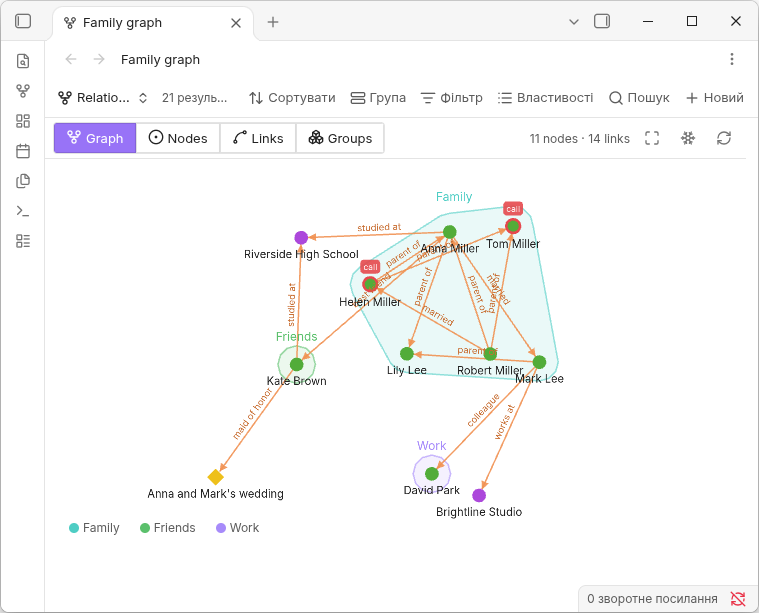
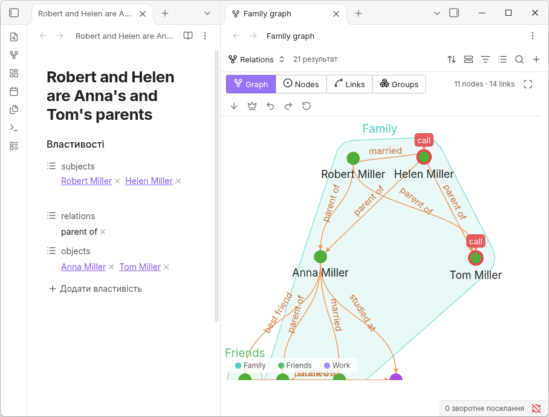
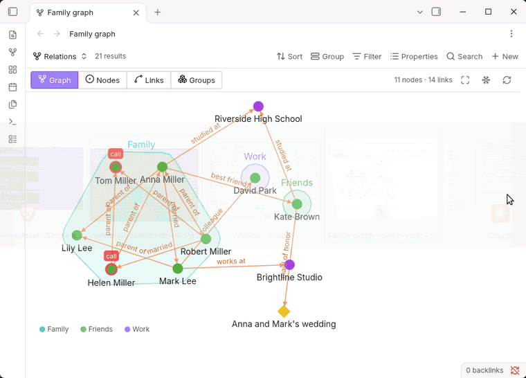
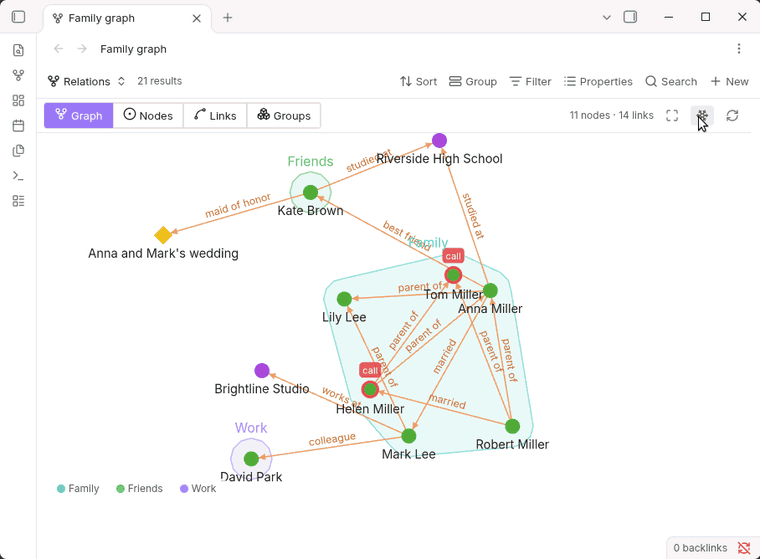

# Bases Relations Graph

A graph view for [Obsidian Bases](https://help.obsidian.md/bases). Every note in the base becomes a node, and you decide — with simple rule tables — which links are drawn and how everything looks.

What makes it different from the core graph:

- **Relations through connector notes.** A note can describe a relationship instead of being a node: `subjects: [[Anna Miller]]`, `objects: [[Mark Lee]]`, `relations: married` becomes a labeled arrow *Anna Miller → Mark Lee*. Ordinary links between notes work too.
- **Full customization of the graph.** Shapes, colors, outlines, sizes, several labels per node, link colors, widths, arrows and label placement — all driven by your note properties through cascading rules, with conditions written exactly like Bases filters.
- **Groups and layouts.** Outline and collapse groups of notes, and switch between a live force layout, a frozen layout you arrange by hand, and a tree.



## Features

- Links from regular note links or from connector notes (any link properties you choose)
- Cascading **Nodes**, **Links** and **Groups** rule tables stored in the `.base` file
- Conditions with the same editor as the Bases *Filter* tab, including value suggestions
- Node shapes, colors, outlines, sizes by property or link count, multiple labels per node
- Link colors, widths by property, arrows, horizontal or along-the-link labels
- Groups by any property (like *Group by* in Bases), with outlines, legend, collapsing and preview
- Layouts: **Force**, **Frozen force** and **Tree**
- Selection, dragging, pinning; positions are remembered per view
- Configurable modifier keys, hotkeys and commands
- Works on desktop and mobile

## Requirements

- Obsidian **1.10** or newer with the core **Bases** plugin enabled.
- The plugin uses part of the internal Bases API to evaluate filter-style conditions. If a future Obsidian version changes it, conditions fall back to a simplified evaluator, and the rest of the plugin keeps working.

## Installation

**From Community plugins** (once published): *Settings → Community plugins → Browse*, search for **Bases Relations Graph**, install and enable.

**Manually:** download `main.js`, `manifest.json` and `styles.css` from the [latest release](../../releases/latest) into `<vault>/.obsidian/plugins/bases-relations-graph/`, then enable the plugin.

**Beta versions:** install with the [BRAT](https://github.com/TfTHacker/obsidian42-brat) plugin using this repository's URL.

## Getting started

1. Open a `.base` file.
2. Add a view and choose the **Relations graph** layout.
3. The graph appears with defaults that mimic the core graph: theme colors, node size by number of links, file name as the label, and all links between the notes.

The toolbar above the graph switches between the **Graph** and its **Nodes**, **Links** and **Groups** tables, and has buttons to fit the graph, freeze the layout and restart the simulation. In the tree layout it also shows orientation, root, undo/redo and reset buttons.

## Try the demo vault

The [`demo-vault`](demo-vault) folder is a small, made-up network of family and friends: people in `People`, places and events in `Places` and `Events`, and relation notes in `Relations` (*married*, *parent of*, *best friend*, *colleague*…). `Family graph.base` has two ready-made views — **Relations** (force layout) and **Tree** (a family tree).

1. Download this repository (*Code → Download ZIP*) and unpack it, or clone it.
2. In Obsidian choose *Open another vault → Open folder as vault* and select `demo-vault`.
3. Turn on community plugins and install **Bases Relations Graph** (see [Installation](#installation)).
4. Open `Family graph.base`.

## Connector notes

A connector note links other notes through its properties:

```yaml
---
subjects:
  - "[[Robert Miller]]"
  - "[[Helen Miller]]"
relations: parent of
objects:
  - "[[Anna Miller]]"
  - "[[Tom Miller]]"
---
```

The default **Links** table already contains a *Connector notes* row: `subjects` → `objects`, labeled with `relations`. The note above (from the [demo vault](#try-the-demo-vault)) produces four arrows — from each parent to each child — all labeled *parent of*. Use any other property names by editing the row or adding new ones.

To keep connector notes themselves off the graph, add a row to the **Nodes** table with a condition that matches them (for example, `file.inFolder("Relations")` in the demo vault) and set *Visibility* to *Hide*.



## Rule tables

The **Nodes**, **Links** and **Groups** tables are edited inside the view and saved in the `.base` file, so they travel with it. Groups are described in [their own section](#groups).

**Nodes** and **Links** rows apply from top to bottom. A later row overrides earlier ones only in the fields it sets; `—` means *inherit*. Every row has a condition, so you can, for example, color all notes in a folder in one row and enlarge a few of them in the next.

### Nodes

- **Condition** — which notes the row applies to.
- **Shape** (circle, square, diamond, triangle), **Color** with opacity, **Stroke** color and width.
- **Size by** — fixed, link count (like the core graph) or any number property, multiplied by **Size value**.
- **Label** — a property or fixed text, with font size, color and background.
- **Label index** — where the label goes: `0` in the center, `1, 2…` stacked above the node, `−1, −2…` below it. Rows with different indexes add labels; rows with the same index override each other.
- **Visibility** — show, hide, or show only if the note has links.

### Links

- **Condition** — which notes create links with this row: the connector note itself, or the note that contains the link. Use it to style links by the connector's own properties.
- **Source** — the note itself, or a link property of a connector note.
- **Target** — all outgoing links of the note, or a link property.
- **Source value / Target value** — optional conditions on the notes at either end.
- **Arrows** to the source and/or target, **Color** with opacity, **Width** fixed or by property.
- **Label** — a property or text; **Label mode** horizontal or along the link; **Label position** in percent from source to target. At 0% and 100% the label touches the node (or the arrow) instead of overlapping it.

Links not described by any row are not drawn.

Several rows that produce the same link are combined like node rows. For example, keep the *Connector notes* row and add rows with only a condition and a style:

| Condition | Style |
|---|---|
| `kind == "friend"` | Color: green |
| `kind == "colleague"` | Color: blue |
| `direction == "both"` | Arrow to source: on |

### Conditions

Conditions use the same building blocks as the Bases *Filter* tab: *All / Any / None* groups, operators that match the property type, and suggestions for folders, tags and existing property values. Any condition can also be written as a raw Bases expression.

## Groups

Each row of the **Groups** table groups notes by a property, like *Group by* in Bases: every distinct value becomes its own group. A note can belong to groups from several rows.

**Setting up**

- **Group by** — the property to group by; notes without a value stay ungrouped.
- **Order** — ascending, descending or manual (choose which values form groups and drag them into order).
- **Color** — from a palette unless set.
- **Label** — the group value, text or a property; the label color can follow the group color.

**On the graph**

- Groups are drawn as soft outlines with their labels and an optional legend. In the force layout members are pulled together and other nodes are pushed out; in the tree layout distant members are outlined as separate islands.
- **Shift + click** a group outline to select all its members.
- **Collapse** a group into a single node (right-click its outline or a member, or click it in the legend); **double-click** the group node to expand it. Positions are kept.
- **Ctrl/Cmd + click** a collapsed group to preview it on top of the dimmed graph. The preview follows the current layout rules, can be rearranged, shows links to outside nodes, and your changes are kept when you expand the group.



## Layouts

Choose the layout in the view options.

### Force

A live force simulation. Center, repel and link forces, link distance and group forces are set in the view options.

### Frozen force

The physics stops and nodes stay exactly where you put them — handy for arranging a map by hand.

- Dragging moves only the dragged (or selected) nodes.
- **Ctrl/Cmd + drag** pulls linked nodes along like threads lying on the floor: a neighbor starts moving only when its link is stretched, and nodes further along the chain move less.
- The restart button recalculates the layout once and freezes it again.



### Tree

Links are read as *parent → child* by their direction. Disconnected parts become separate trees.

- **Choose root** and click a node to rebuild its part of the graph around it.
- **Orientation** — grow the map down, right, up or left.
- Drag a node to place it freely; its descendants follow. **Ctrl/Cmd + drag** moves the node alone.
- Undo/redo, reset, and curved, straight or orthogonal link styles.

## Interaction

| Action | Result |
|---|---|
| Click a node | Open the note |
| Double-click a node | Open the note in a new tab |
| Shift + click a node | Add to / remove from selection |
| Shift + drag on empty space | Selection box |
| Drag a node | Move it (or the whole selection) |
| Right-click a node or group | Context menu: open, pin, collapse group, tree actions |
| Wheel / pinch | Zoom |
| Drag empty space | Pan |
| Esc | Clear selection / close preview |

On mobile, long-press opens the context menu, and the selection-mode button in the toolbar turns taps into selection.

Node positions are remembered per view; pinned nodes stay fixed even in the force layout.

## Settings and commands

In *Settings → Bases Relations Graph* you can change the modifier keys used for selection, preview, threads and single-node tree moves, and assign hotkeys to graph actions. The same actions are available in the command palette: fit graph, toggle freeze, restart simulation, select all, clear selection, and tree undo, redo, choose root and reset.

## Performance

Rendering uses WebGL (Pixi.js) and the simulation runs in a background worker. Graphs with thousands of nodes stay responsive; with tens of thousands, rebuilding the tree layout takes around a second.

## Data and privacy

The plugin makes no network requests. Rule tables are stored in your `.base` files; node positions, tree layouts and collapsed groups are stored in the plugin's data.

## Known limitations

- In the tree layout, labels on curved links are placed along a straight line.
- A note that belongs to several collapsed groups is shown inside the first of them.
- Filter-style conditions depend on the internal Bases API (see Requirements).

## License

[MIT](LICENSE). Bundles [Pixi.js](https://pixijs.com) (MIT) and [d3-force](https://github.com/d3/d3-force) (ISC).
